# LEDCare OS — ITIL tabanlı teknik servis platformu

> **Vitrin deposu.** Kaynak kod özel (private) bir depoda tutulur; bu depo yalnızca ürünü, mimariyi ve ekran görüntülerini tanıtır.
> Görüntülerdeki şirket ve kişi adları deneme verisidir. Kod incelemesi için iletişime geçebilirsiniz.
>
> *English summary below.*

LEDCare OS, LED ekranlar için merkezden yönetilen bir teknik servis ve servis masası (service desk) platformudur. Müşteri arızayı bildirir;
servis masası kaydı ITIL terimleriyle sınıflandırır, önceliklendirir, SLA'ya bağlar ve gerekirse eskale eder. İş uzaktan bağlantıyla
ya da sahaya gönderilen teknisyenle çözülür. Tekrarlayan arızalar problem kaydında izlenir ve bilinen hata olarak belgelenir.

**Kapsam:** ASP.NET Core 10 API · Next.js web uygulaması (müşteri portalı, yönetim paneli, teknisyen ekranları) · Flutter mobil uygulama
(Android/iOS) · PostgreSQL 17 · SignalR ile anlık güncelleme · Firebase anlık bildirim.

## ITIL / ITSM özellikleri

| ITIL kavramı | Platformdaki karşılığı |
|---|---|
| **Servis talebi ve olay (incident)** | Her kayıt `Servis talebi` (planlı iş, ör. periyodik bakım) ya da `Olay` (beklenmeyen kesinti) olarak sınıflandırılır |
| **Öncelik matrisi** | Öncelik elle seçilmez: **etki × aciliyet** matrisinden P1–P4 hesaplanır |
| **Yanıt ve çözüm SLA'ları** | Önceliğe ve arıza türüne göre eşleşen politika; ilk yanıt ve çözüm saatleri, "riskte" / "aşıldı" durumları, SLA takip listesi |
| **Fonksiyonel eskalasyon** | Kayıt bir üst destek hattına çıkar: 1. seviye servis masası → 2. seviye teknik destek → 3. seviye uzman |
| **Hiyerarşik eskalasyon** | Yönetim uyarılır; karar yetkisi gerektiren durumlar için (kaynak, müşteri iletişimi) |
| **Otomatik eskalasyon kuralları** | "İlk yanıt aşıldı → 2. seviye", "Çözüm aşıldı → 3. seviye", "İlk yanıt riskte → yönetim" gibi kurallar arka plan işinde bir kez tetiklenir |
| **Problem yönetimi** | Tekrarlayan olayların ortak nedeni `PRB-000001` kaydında izlenir; olaydan doğrudan problem açılır |
| **Bilinen hata (known error) ve KEDB** | Kök neden ve geçici çözüm yazılmadan kayıt "bilinen hata" olamaz; geçici çözüm bağlı tüm olaylarda görünür, aranabilir bilinen hata veritabanı |

Öncelik matrisi:

| Etki ↓ / Aciliyet → | Yüksek | Orta | Düşük |
|---|---|---|---|
| **Yüksek** | P1 Acil | P2 Yüksek | P3 Normal |
| **Orta** | P2 Yüksek | P3 Normal | P4 Düşük |
| **Düşük** | P3 Normal | P4 Düşük | P4 Düşük |

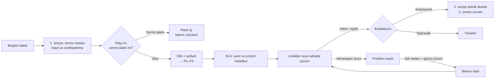

### Ekran görüntüleri — servis masası

<table>
  <tr>
    <td width="50%">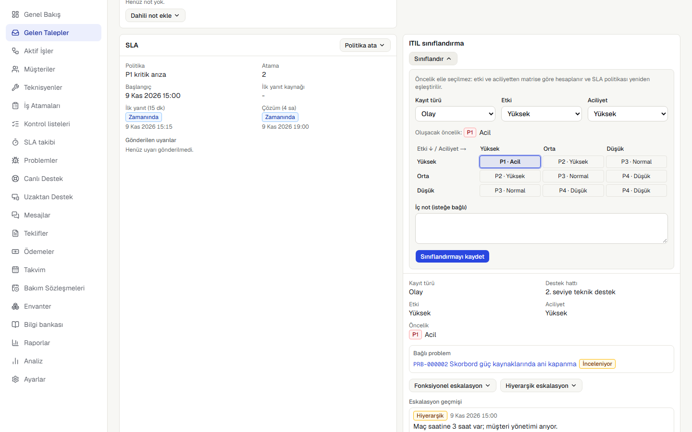 <b>Sınıflandırma.</b> Etki ve aciliyet seçilince öncelik matristen gelir (P1 · Acil) ve SLA politikası yeniden eşleşir.</td>
    <td width="50%">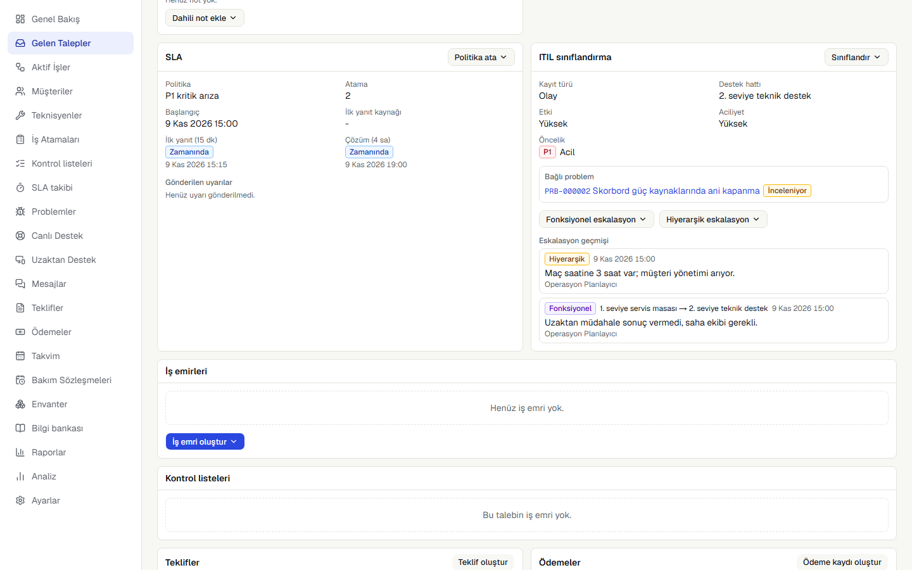 <b>SLA ve ITIL panelleri.</b> Yanıt ve çözüm saatleri, destek hattı, bağlı problem, eskalasyon geçmişi.</td>
  </tr>
  <tr>
    <td>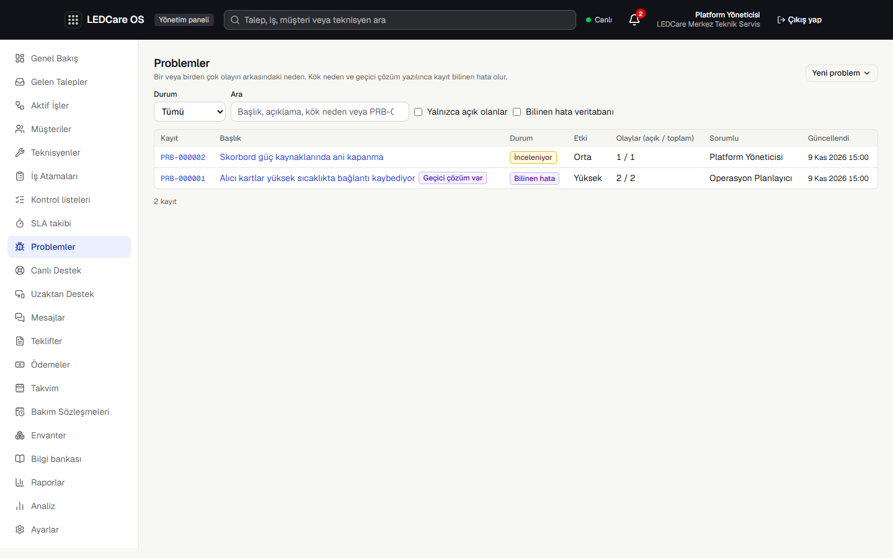 <b>Problem yönetimi.</b> Açık problemler, bilinen hata veritabanı süzgeci, bağlı olay sayıları.</td>
    <td>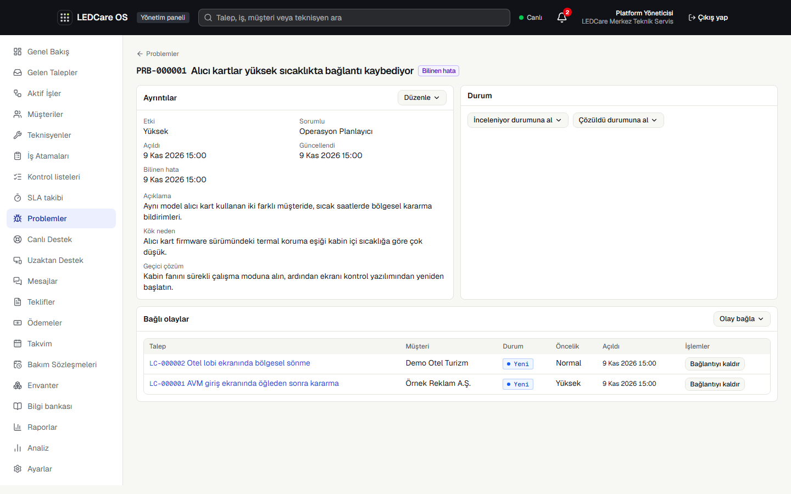 <b>Bilinen hata.</b> Kök neden, geçici çözüm ve iki farklı müşterideki bağlı olaylar.</td>
  </tr>
  <tr>
    <td>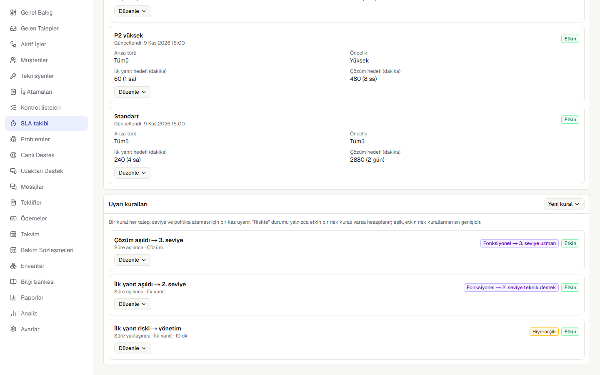 <b>Eskalasyon kuralları.</b> Hiyerarşik uyarı ve hedef destek hattıyla fonksiyonel kurallar.</td>
    <td>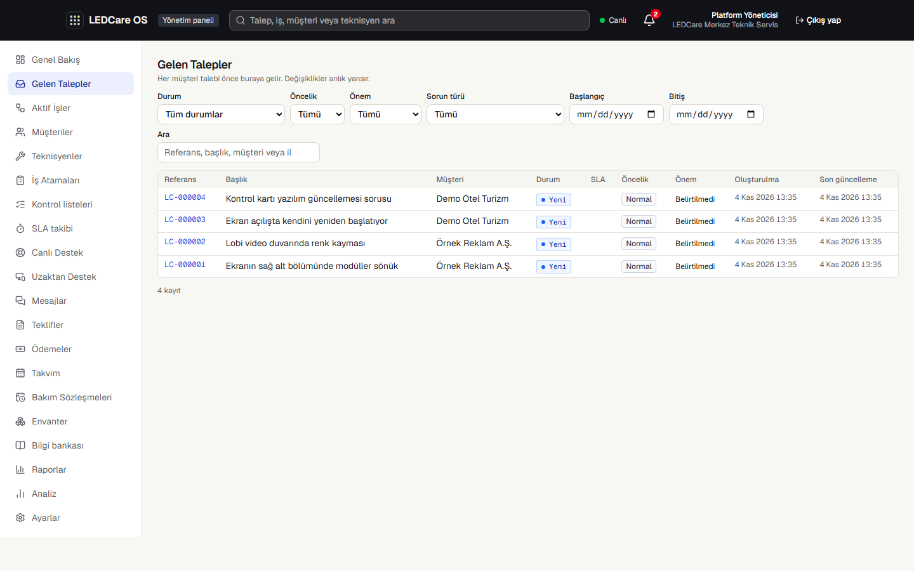 <b>Gelen talepler.</b> Durum, öncelik, önem, arıza türü ve tarihe göre süzme.</td>
  </tr>
</table>

### Ekran görüntüleri — operasyon, müşteri ve saha

<table>
  <tr>
    <td width="50%">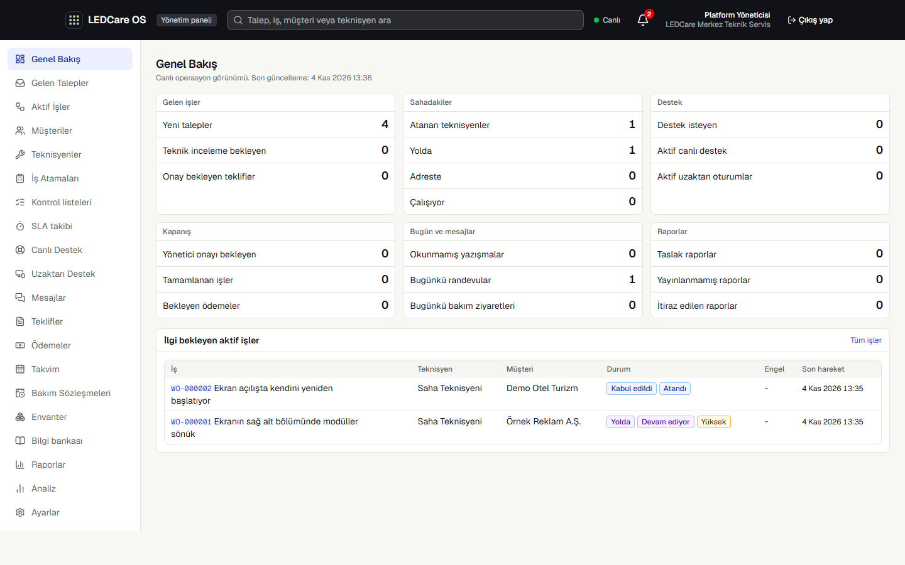 <b>Operasyon paneli.</b> Her sayı ilgili filtreli listeye götürür ve anlık güncellenir.</td>
    <td width="50%">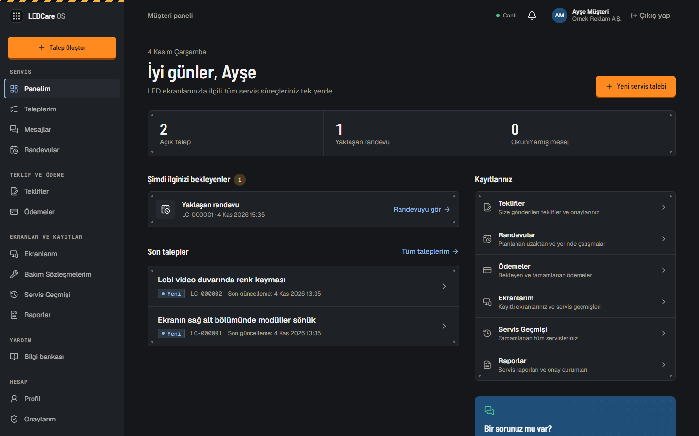 <b>Müşteri paneli.</b> Açık talepler, randevular, mesajlar ve kayıtlar.</td>
  </tr>
  <tr>
    <td>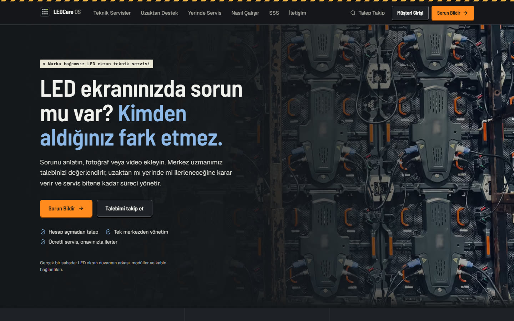 <b>Tanıtım sitesi.</b> Hesap açmadan arıza bildirme ve talep takibi.</td>
    <td>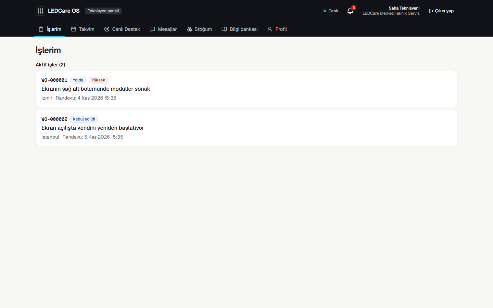 <b>Teknisyen paneli.</b> Yalnızca atanan işler.</td>
  </tr>
</table>

<table>
  <tr>
    <td width="33%">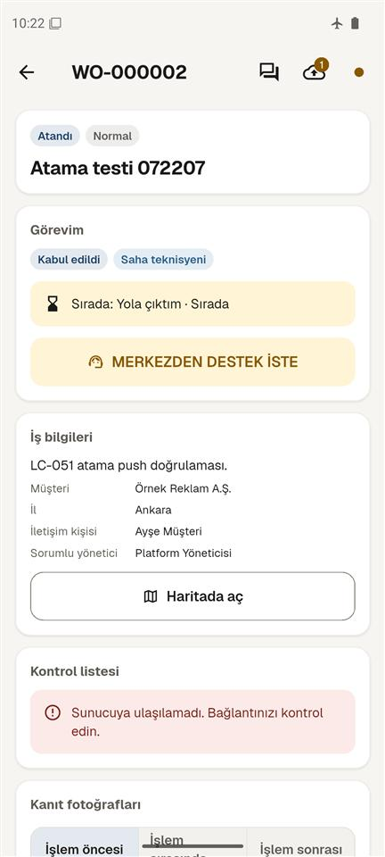 <b>Mobil iş ekranı.</b> Çevrimdışıyken adım kuyrukta bekler; "Merkezden destek iste".</td>
    <td width="33%">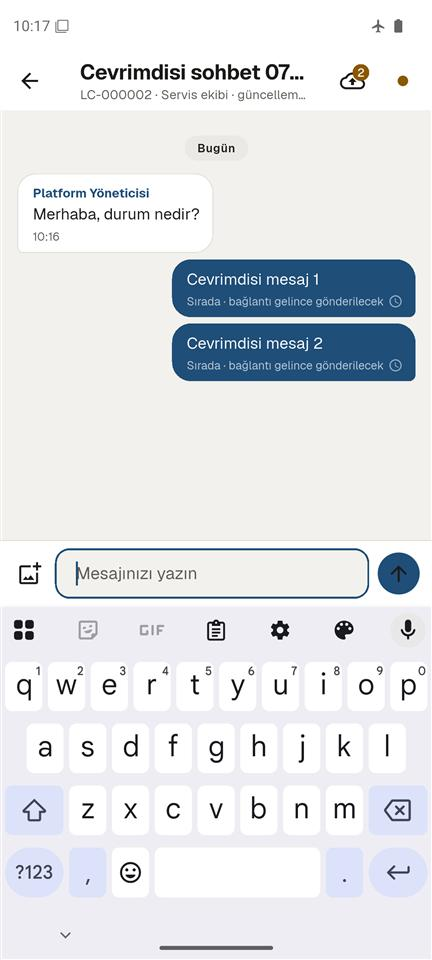 <b>Servis ekibiyle sohbet.</b> Çevrimdışı mesajlar bağlantı gelince gönderilir.</td>
    <td width="33%">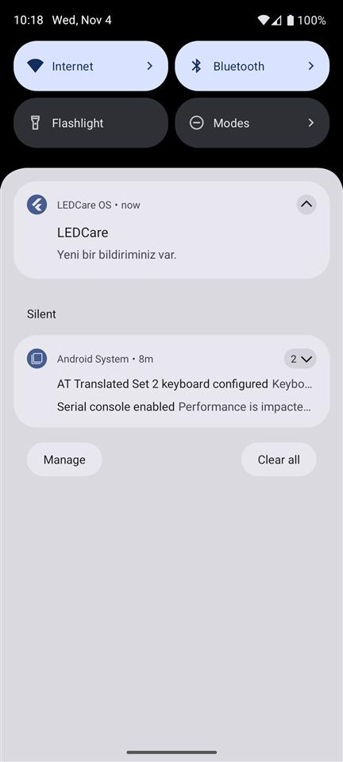 <b>Anlık bildirim.</b> Bildirim içerik taşımaz; uygulama ayrıntıyı API'den çeker.</td>
  </tr>
</table>

## Mimari ve mühendislik

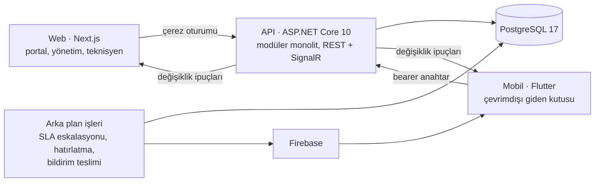

- **Tek doğru kaynak API:** Web ve mobil aynı API'yi kullanır; aralarında ayrı senkronizasyon yoktur. SignalR yalnızca kimlik taşıyan ipuçları gönderir, istemci veriyi REST'ten yeniden okur.
- **Yetkilendirme sunucuda:** Organizasyon kapsamı ve kayıt görünürlüğü her istekte API'de doğrulanır; kapsam dışı kayıtlar 404 döner. SLA, ITIL ve problem verisi yalnızca servis masasına (yönetici ve operasyon) görünür.
- **Tutarlılık:** İyimser eşzamanlılık (sürüm kontrolü, 409), aynı işlemde yazılan geçmiş, denetim ve bildirim kayıtları; eskalasyon her kural, seviye ve SLA revizyonu için yalnızca bir kez tetiklenir (benzersiz indeks).
- **Çevrimdışı mobil:** Kuyruktaki işlemler aynı `Idempotency-Key` ile yeniden gönderilir, kayıt çoğalmaz.
- **Test:** Gerçek PostgreSQL üzerinde (Testcontainers) 465 backend entegrasyon testi, web birim testleri ve Playwright uçtan uca testleri (ITIL ve SLA akışları dahil), Flutter widget testleri. API sözleşmesi OpenAPI'den dışa aktarılır ve CI'da sapma kontrolü yapılır.

| Katman | Teknoloji |
|---|---|
| API | ASP.NET Core 10 minimal API, EF Core 10, ASP.NET Identity, SignalR |
| Web | Next.js, React, TypeScript, Tailwind CSS, Vitest, Playwright |
| Mobil | Flutter, Riverpod, GoRouter, Dio, Firebase Cloud Messaging |
| Veri | PostgreSQL 17 (satır düzeyi güvenlik açık), Supabase Storage |
| Süreç | GitHub Actions, OpenAPI sözleşmesi, özellik dalları ve PR akışı |

---

## English summary

**LEDCare OS** is a service-desk and field-service platform for LED-screen technical support, built around **ITIL** practices.
This is a **showcase repository**: the source code is private; this repo presents the product, architecture and screenshots
(all names in screenshots are demo data).

- **Service requests vs. incidents**, classified by the service desk.
- **Priority matrix:** impact × urgency gives P1–P4; the matching **SLA policy** (first-response and resolution targets) follows automatically.
- **SLA monitoring** with at-risk and breached states and a watch list.
- **Functional escalation** (1st-line service desk → 2nd-line technical support → 3rd-line expert) and **hierarchical escalation** (management), manual with a reason or driven by SLA rules, with full history.
- **Problem management** with **known errors** (root cause + workaround required) and a searchable **known error database**; incidents link to problems and show the workaround.
- Stack: ASP.NET Core 10, EF Core, PostgreSQL 17, SignalR, Next.js + TypeScript, Flutter, Firebase; 465 backend integration tests on a real database, Playwright E2E and Flutter widget tests.

© Halil Mert Develi. Tüm hakları saklıdır / All rights reserved.
